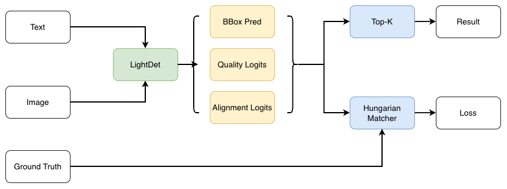
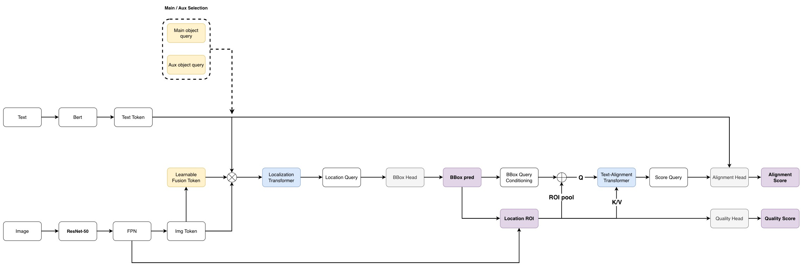

# LightDet


LightDet 是文字引導的多模態物件偵測模型。模型輸入影像與文字描述，輸出與描述相符的邊界框、定位品質分數與文字對齊分數。

```text
Image + Text Phrases -> Object Queries -> Boxes + Quality + Phrase Alignment
```

目前 ResNet 版本使用 ImageNet V2 預訓練 ResNet-50、FPN、多模態 Decoder-only Object Queries、FPN ROI refinement 與 Main/Auxiliary matching。Quality 與描述匹配分開監督，推論再融合分數。資料標註使用 `lightdet.relations.v1`，同一個物件可以對應多段描述；原 BottleNet 設定保留供比較。

<details>
<summary><em>當前限制 / Current Limitations</em></summary>

ResNet 實驗已完成 100 epoch；既有 epoch 55 權重重新驗證後，單目標 Acc@0.5 為 49.45%，GREC 集合成功率為 0.59%。後期語意泛化與多報控制仍有改善空間；實際端到端推論延遲尚未量測。

---

The ResNet experiment completed 100 epochs. Re-evaluation of the existing epoch-55 checkpoint gives 49.45% single-target Acc@0.5 and 0.59% GREC exact-set success. Semantic generalization and extra detections remain limitations. End-to-end inference latency has not been measured.

</details>

---

## 簡介

### 模型能力


模型可使用多種文字條件查詢同一張影像，例如「單色紅色的船」與「含紅色的船」。同一個物件只保留一份定位框，描述關係由物件 ID 建立。

目前資料集包含 10,733 張訓練影像與 2,683 張驗證影像。
ResNet 實驗使用 `lightdet_grounding_resnet50_roi8_hardneg_log_100ep`；既有 epoch 55 EMA checkpoint 已依 GREC 規則重新驗證，結果見下表。

**模組演進與績效比較**

使用相同驗證集（2,683 張影像、17,395 段描述）及 GREC 官方參考評估規則重新計算；Acc@0.5 僅計入 11,392 段單目標描述。

| 階段 | checkpoint epoch | GREC Pr@(F1=1) | 單目標 Acc@0.5 | N-acc |
|---|---:|---:|---:|---:|
| Baseline | 61 | 13.11% | 43.11% | N/A |
| Baseline + ROI  | 45 | 0.79% | 43.07% | N/A |
| ResNe + ROI | 55 | 0.59% | 49.45% | N/A |

> [!NOTE]
> 以上使用過去依 Hit@1 選出的 EMA checkpoint，並非各實驗的最佳 GREC checkpoint；原始版與 ROI 版由完整預測重算，ResNet 版重新驗證。這些是累積版本比較，初始化與排程未完全控制，不能歸因於單一模組。驗證集沒有無目標描述，因此 N-acc 為 N/A。
> GREC 要求全部物件正確且沒有多報；重複候選也算多報，不能與過去的 Hit@1 數值直接比較。詳細規則及來源見「驗證與後處理」；[重算結果與權重來源](./docs/grounding_comparison.json)。

### 模型資料流




Main／Aux 分別採一對一／一對多定位配對，Aux 僅用於訓練。描述關係由標記矩陣提供，Quality、Alignment 與 Ranking 分別監督；GT ROI 暖機輔助語意學習。

### 模型結構



| 模組 | 說明 |
|---|---|
| `BackBone` | ResNet-50 layer2／3／4 輸出 stride 8／16／32、512／1024／2048 通道；影像先做 ImageNet 正規化，固定 BN 統計但保留 affine 訓練；原 BottleNet 路徑保留 |
| `FPN` | 融合三個尺度，統一至 256 通道；同時供定位 token 與原始 FPN ROI 擷取使用 |
| `Image Projector` | 各尺度使用獨立投影與 refinement，輸出 24×24、12×12、10×10，共 820 個 256 維 image tokens；ROI 不從這些縮小的 tokens 裁切 |
| `Bert` | 凍結 MacBERT 編碼完整 caption；可訓練的 Linear → LayerNorm → GELU 將文字由 768 投影至 256 維，使用 raw BERT 快取 |
| `Main object query / Aux object query` | 各 100 個候選 query；Main 使用 one-to-one，Aux 最多 3 個 query 對應一個 GT，僅訓練使用 |
| `Learnable Fusion Token` | 提供多模態融合 query，與物件 queries 一起進入定位階段 |
| `Localization Transformer` | 使用影像與文字 context，產生 Location Query |
| `BBox Head` | 從 Location Query 預測正規化 xyxy BBox |
| `BBox Query Conditioning` | 將 detach 的 BBox 幾何資訊編碼為評分 query；不直接沿用 Location Query 特徵 |
| `ROI Align` | 根據各候選 BBox，從 FPN feature maps 擷取 8×8、256 通道的局部特徵 |
| `Text-Alignment Transformer` | ROI pooled feature＋BBox embedding 經每個 ROI 自己的 64 個 tokens 做局部 refinement，產生 Score Query；不讀取文字，也不讓不同 bbox queries 互相 attention |
| `Alignment Head` | ROI／文字各自 LayerNorm＋Linear 256→256；文字依描述 span 加權池化，與 ROI 做正規化相似度及配對 MLP，輸出 `[Q,P]` logits |
| `Quality Head` | ROI 平均池化後走獨立視覺投影及 Quality Head，輸出 `[Q,1]` logits，經 sigmoid 預測最大 GT IoU；不接收文字或 Score Query |
| `Phrase Ranking` | 融合 `sqrt(Quality × Alignment)`，依描述分別排序；輸出使用閾值與 NMS，GREC 評估另使用 0.7 閾值且不使用 NMS |

前段 FPN、BERT 投影與 ROI refinement 由 Main／Aux 共用，各自有獨立的 BBox、Quality 與 Alignment Head。描述匹配採 `cosine(v,t) + 0.25 × tanh(MLP([v*t, |v-t|]))`，MLP 為 512→64→1，再用可學習 scale／bias 轉成 logits。每個 ROI 只做一次 refinement，所有描述共用其視覺摘要；描述不會重新引導 ROI 空間注意力。

---

## 專案結構

```text
LightDet/
├── datasets/
│   ├── images/{train,val}/
│   ├── labels/{train,val}/
│   └── .cache/
├── units/
│   ├── model/
│   │   ├── cards/
│   │   │   ├── config/{model.yaml,train.yaml,model_resnet50.yaml,train_resnet50.yaml}
│   │   │   ├── loss.py
│   │   │   └── relation_loss.py
│   │   ├── pipeline/{data.py,relations.py}
│   │   ├── tool/
│   │   └── train.py
│   └── tool/card.py
├── migrate_annotations.py
└── requirements.txt
```

---

## 安裝

### 1. 下載專案

```bash
git clone https://github.com/ImChouOWO/LightDet.git
cd LightDet
```

### 2. 建立虛擬環境

```bash
python3 -m venv venv
source venv/bin/activate
python3 -m pip install --upgrade pip
pip install -r requirements.txt
```

`requirements.txt` 已包含目前環境使用的 PyTorch、TorchVision、Transformers、SciPy、Pillow 與 PyYAML。CUDA 版本應與目標 GPU 的 PyTorch 安裝相容。

---

## 資料集格式

資料集目錄如下：

```text
datasets/
├── images/train/
├── images/val/
├── labels/train/
└── labels/val/
```

影像與標記檔使用相同檔名：

```text
datasets/images/train/000001.jpg
datasets/labels/train/000001.json
```

標記檔使用 `lightdet.relations.v1`：

```json
{
  "schema_version": "lightdet.relations.v1",
  "filename": "2021_10_20_13_28_41_00000.jpg",
  "height": 1296,
  "width": 2304,
  "grounding": {
    "caption": "黃綠白相間的船。含綠色的船。",
    "phrases": [
      {
        "id": "phrase_0000",
        "semantic_key": "colors_exact:白色|黃色|綠色",
        "phrase": "黃綠白相間的船",
        "tokens_positive": [[0, 7]],
        "positive_object_ids": ["object_0000"],
        "negative_object_ids": ["object_0001"],
        "ignore_object_ids": []
      },
      {
        "id": "phrase_0001",
        "semantic_key": "contains_color:綠色",
        "phrase": "含綠色的船",
        "tokens_positive": [[8, 13]],
        "positive_object_ids": ["object_0000", "object_0001"],
        "negative_object_ids": [],
        "ignore_object_ids": []
      }
    ]
  },
  "objects": [
    {
      "id": "object_0000",
      "bbox": [1858, 493, 2017, 558],
      "attributes": {
        "colors": ["白色", "綠色", "黃色"],
        "colors_complete": true
      }
    },
    {
      "id": "object_0001",
      "bbox": [1590, 454, 1653, 501],
      "attributes": {
        "colors": ["綠色"],
        "colors_complete": true
      }
    }
  ]
}
```

| 欄位 | 必要 | 說明 |
|---|---:|---|
| `schema_version` | 是 | 必須為 `lightdet.relations.v1` |
| `filename` | 是 | 對應影像檔名 |
| `grounding.caption` | 是 | 包含所有文字描述的完整字串 |
| `grounding.phrases` | 是 | 描述及其物件關係 |
| `phrases[].tokens_positive` | 是 | 描述在 caption 中的字元區間 |
| `positive_object_ids` | 是 | 確認符合描述的物件 |
| `negative_object_ids` | 是 | 確認不符合描述的物件 |
| `ignore_object_ids` | 是 | 資訊不足、不得計入該描述 loss 的物件 |
| `objects[].id` | 是 | 同一張影像內唯一的物件 ID |
| `objects[].bbox` | 是 | 原始影像像素座標 `[x1,y1,x2,y2]` |
| `objects[].attributes` | 建議 | 用於保存顏色等可解釋屬性 |

同一個物件可以對應多個 phrase，但 `objects` 中只保留一份 bbox。資料載入時會將 bbox 轉為模型輸入尺寸並正規化。

---

## Query Budget Batch

`query_budget: true` 時，`batch_size` 代表一個 batch 的 region 預算，每批另設最多 6 張影像。資料集會依影像的描述數量組合 batch，並在每個 epoch 重新排序與組批，避免固定分組造成樣本分布偏差。

```yaml
data:
  query_budget: true

train:
  batch_size: 48
```

訓練資料會輪替可靠的短同義描述；過長或不符合既定語意規則的 `phrase_variants` 不會被抽樣。外部負文字池目前停用，負例由標記內的關係矩陣提供。

---

## 文字編碼與快取

文字分支使用 `hfl/chinese-macbert-base` 相容的 BERT 權重，並預設凍結 BERT：

```yaml
model:
  freeze_bert: true
  precomputed_bert_path: units/model/cards/cache/bert_raw_cache.pt
```

訓練啟動時會建立或補充文字特徵快取。`text_max_length` 為 256；若 phrase 超出 tokenizer 長度，資料驗證會拒絕該樣本。

---

## 模型設定

BottleNet 設定：`units/model/cards/config/model.yaml`

ResNet    設定：`units/model/cards/config/model_resnet50.yaml`。

```yaml
model:
  hidden_dim: 256
  backbone:
    name: resnet50
    in_channels: 3
    weights: IMAGENET1K_V2
    norm_eval: true
  fpn:
    out_channels: 256
  num_object_queries: 100
  num_heads: 8
  num_layers: 2
  staged_query_refinement: true
  score_num_heads: 8
  score_num_layers: 2
  score_roi_size: 8
  score_bbox_detach: true
  score_fusion: geometric_mean
  text_max_length: 256
  freeze_bert: true
  use_auxiliary_head: true
```


---

## 訓練設定


```yaml
train:
  epochs: 100
  localization_freeze_epochs: 0
  batch_size: 48
  warmup_epochs: 5
  use_amp: true
  amp_dtype: bf16

loss:
  score_sampling:
    max_positive_per_gt: 3
    min_extra_positive_iou: 0.30
  text_alignment:
    ranking_weight: 0.25
    ranking_contrast_weight: 0.01
    ranking_contrast_temperature: 0.1
    ranking_margin: 0.6931471805599453 # ln(2)
    ranking_negative_top_k: 5
    ranking_hard_negative_quota: 3
  gt_roi:
    weight: 0.5
    hold_epochs: 5
    end_epoch: 15

log:
  save_dir: units/model/runs/train/lightdet_grounding_resnet50_roi8_hardneg_log_100ep
  weights_path: units/model/runs/train/lightdet_grounding_roi8_phrase_pair_100ep/best_hit_at_1.pt
  weights_exclude_prefixes: ["img_model."]
  resume_path: null
```


---

## Loss 與 Matching

### Main branch

以 BBox L1＋GIoU 成本進行 Hungarian one-to-one matching，每個唯一 GT 物件配對一個 query，提供定位監督。

### Auxiliary branch

每個 GT 最多配對 3 個 query，且 IoU ≥ 0.30，提供額外定位、Quality 與 Alignment 監督；僅用於訓練。

### Relation loss

將唯一對應 GT 且 IoU ≥ 0.5 的 query，依物件 ID 連結描述關係矩陣，建立正例、負例與忽略標籤。

| Loss | 運作機制 |
|---|---|
| BBox／GIoU | 讓配對 query 的預測框接近 GT |
| Quality | 學習預測框與 GT 的最大 IoU，可靠背景目標為 0 |
| Alignment | 使用 focal BCE，學習物件是否符合各段描述；未知關係忽略 |
| Ranking | 結合雙向 log-margin 排序與對比學習，優先比較同圖語意困難負例，使正例分數高於負例 |
| GT ROI 暖機 | 訓練初期以 GT 框擷取 ROI 輔助語意學習，再逐步移除 |


> 背景標籤由預測框與全部 GT 的幾何關係建立，逐步加入監督。Ranking 中的 Quality 停止梯度，避免排序任務改變定位品質目標。
> 
> 各項 loss 加權合併；推論以 `sqrt(Quality × Alignment)` 排序，再以閾值與描述內 NMS 篩選結果。

---

## 啟動訓練

```bash
cd /PATH/TO/LightDet
source venv/bin/activate
python3 units/model/train.py \
  --model-config units/model/cards/config/model_resnet50.yaml \
  --train-config units/model/cards/config/train_resnet50.yaml
```


---

## Checkpoint 與續訓

ResNet 輸出目錄：

```text
units/model/runs/train/lightdet_grounding_resnet50_roi8_hardneg_log_100ep/
```

不載入任務 checkpoint：

```yaml
log:
  weights_path: null
  weights_exclude_prefixes: []
  resume_path: null
```


---

## 驗證與後處理

```yaml
eval:
  eval_interval: 1
  score_thr: 0.5
  nms_iou_thr: 0.5
  use_nms: true
  best_metric: grec_precision_f1
```

正式評估採用 [GREC／gRefCOCO 官方參考程式](https://github.com/henghuiding/gRefCOCO/blob/main/mdetr/datasets/refexp.py)，指標以 0–1 記錄：

| 指標 | 定義 |
|---|---|
| `grec_precision_f1` | Pr@(F1=1)：描述對應的全部物件都正確且沒有多報，才算成功；作為主要指標 |
| `grec_n_acc` | 無目標描述是否輸出空集合；沒有此類描述時為 N/A |
| `grec_t_acc` | 有目標描述是否至少輸出一個框；不代表框的位置或語意正確 |
| `rec_acc50` | 僅對單目標描述，最高分框與 GT 的 IoU >0.5 是否命中 |

GREC 使用融合分數 ≥0.7 的原始 Main 候選，不使用 NMS 或 Top-K 補框，逐次選取最高重疊的一對框配對。**官方程式實際使用 GIoU ≥0.5**，此處如實重現並記錄為 `lightdet.grounding.v3`，不將舊 `Set Success50` 直接改名。自有資料的未知關係仍忽略；官方資料沒有這種額外關係標籤。

Hit@K、TextHit@1、QualityHit@1、Object Recall 與 Oracle50 僅保留為候選／排序診斷，不列為正式績效或最佳 checkpoint 依據。自有資料使用公認評估規則，不代表數值可直接與 gRefCOCO 資料集上的論文結果比較。

推論仍使用 `score_thr=0.5` 與 NMS IoU=0.5；此後處理與 GREC 評估分開。新訓練依 `grec_precision_f1` 保存 `best_grec_precision_f1.pt`。

已有完整預測時，可不執行模型、直接重新評估：

```bash
python3 units/model/rescore_grounding.py /PATH/TO/predictions.jsonl.gz \
  --output /PATH/TO/metrics_grec.json
```

---

## 訓練輸出

| 檔案 | 說明 |
|---|---|
| `latest.pt` | 最近一次完整 checkpoint |
| `best_grec_precision_f1.pt` | GREC 集合成功率最佳 checkpoint |
| `epoch_XXX.pt` | 每 10 epoch 保存的 checkpoint |
| `metrics_epoch.jsonl` | Epoch-level 訓練與驗證指標 |
| `latest_metrics.json` | 最近一次摘要 |

---

## 參考資料

- [DETRs Beat YOLOs on Real-time Object Detection](https://arxiv.org/abs/2304.08069)
- [Grounding DINO: Marrying DINO with Grounded Pre-Training for Open-Set Object Detection](https://arxiv.org/abs/2303.05499)

## License

本專案採用 [MIT License](./LICENSE)。使用、修改、發布或再散布本專案及其衍生作品時，請保留 `LICENSE` 中的原作者版權聲明與授權條款，並標記原作者 **Cheng-Han Chou**。
